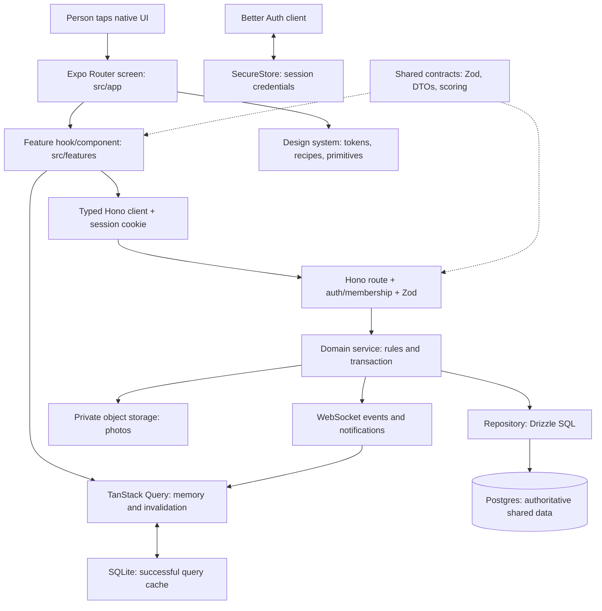

# Between: learning the Expo architecture through this repository

Updated 2 November 2026. This guide describes the inspected working tree. Proposed changes are explicitly labeled. Open the [interactive field guide](expo-architecture.html) to step through notes, quizzes and photo storage visually. Start here, then follow the source links and existing [ADRs](adr/).

## The overall picture

React Native supplies native UI primitives and rendering; Expo supplies the framework, SDK modules, development/build tooling and Router used around them. Between is a native application talking to a separate backend, not a website inside a wrapper. The package declares Expo `~57.0.25`, React Native `0.86.3`, React `19.2.3`. `bunx expo install --check` currently reports thirteen patch-range differences; that is a compatibility task, not an automatic instruction to upgrade.

A screen decides presentation and handles taps. A hook coordinates remote state. A service owns domain rules. A repository owns SQL. Contracts define what crosses boundaries. Keeping these roles makes a failure traceable rather than spreading the same rule across both devices.

## Repository map

| Path | Responsibility / first file to open |
|---|---|
| `apps/mobile/index.ts` | Startup imports Router entry and registers the Android widget handler |
| `apps/mobile/src/app/_layout.tsx` | Fonts/splash, theme, persisted cache, protected root stack, realtime, push and widget coordination |
| `apps/mobile/src/app/(tabs)/_layout.tsx` | Main tab navigator; `components/TabBar.tsx` owns its appearance |
| `apps/mobile/src/features` | Feature-specific hooks and UI, e.g. `notes/hooks.ts`, `quizzes/QuizPlay.tsx` |
| `apps/mobile/src/design-system` | Shared Text/Button/Screen, semantic themes, recipes, art and motion |
| `apps/mobile/src/lib` | Transport, auth, storage, query client, errors, upload, realtime and preferences |
| `apps/api/src/app.ts` | Hono mounting and shared middleware; exported in-process app used by tests |
| `apps/api/src/index.ts` | Bun HTTP/WebSocket server, content sync and cleanup timers |
| `apps/api/src/modules` | Routes → service → repository, exported through module `index.ts` |
| `apps/api/src/db/schema`, `drizzle` | Drizzle table definitions and SQL migration history |
| `packages/contracts/src` | Runtime Zod validators, shared types/copy/scoring; not database access |
| `content/quizzes` | Repo-authored content synced to catalog on API boot |
| `deploy` | Docker/Caddy and production configuration examples |

## Router, groups and layouts

Files under `src/app` become routes. `(tabs)` is a grouping name and does not add a literal URL segment: `(tabs)/today.tsx` is `/today`. `[id].tsx` is a dynamic parameter, e.g. `/notes/<uuid>`. `_layout.tsx` creates a navigator/provider boundary, not an ordinary destination. Keep reusable helpers out of this directory or Router may treat them as routes.

Root `Stack.Protected` guards use `features/space/flow.ts`:

`loading → signed-out → needs-name → no-space → waiting → ready` (or `naming` for an active unnamed pet)

This is a branching state machine: no-pet setup can go straight to ready, existing members skip earlier states. `flowState` derives it from auth session and `/me`; `HOME_FOR` supplies landing routes. `app/index.tsx` redirects accordingly. Backend remains the authorization authority: hiding a route never grants or revokes server access.

`router.push` adds a screen so Back returns to the caller. `replace` substitutes a completed/transitional destination, such as new journal → saved page. Native stack animation options differ for editor/detail screens. `invite/[code].tsx` stores a pending invitation across authentication; `onboarding-intent.ts` separately remembers create/join. `restorablePath` filters setup paths when restoring a cold-start deep link. Warm links, closed-space access and session expiry deserve device tests, not assumptions from route names.

The root still contains comments/last-path logic referring to old theme remounts; current ThemeProvider does not key-remount navigation. Treat comments as clues and inspect rendered structure before explaining behavior.

## Components, rendering and the design system

React functions return descriptions of UI. `useState` or subscribed context/query changes cause React to render those functions again; React Native reconciles the result into native views. Rendering is not the same as remounting: rerender normally preserves input state; a changed key or removed protected route can destroy it. This distinction explains why themes subscribe without rebuilding the entire navigator.

`design-system/Text.tsx`, `Button.tsx` and `Screen.tsx` centralize type, touch targets, loading, safe areas, scroll and keyboard avoidance. Feature objects such as `NoteCard` express domain-shaped visuals without fetching data. `features/quizzes/QuizPlay.tsx` combines those with answer state and mutations. `Screen` is not a replacement for virtualized lists; Notes/Remember use list structures for large data, and `MemoryGallery.tsx` uses FlashList masonry and a separate viewer.

`theme/themes.ts` contains four personal palettes, each light/dark, and fixed artwork colors. `theme-preference.ts` migrates old preferences. `ThemeProvider.tsx` resolves color and System/Light/Dark. `tokens.ts` exposes live palette/identity values; `recipes.ts` decides shared control treatments. Consumers call `useThemeSubscription()` so mutable palette reads redraw. Do not hardcode another blue in a screen. Fixed artwork and widget art are intentional, not every colored shape is an interactive accent.

Reanimated powers purposeful UI motion (`design-system/motion.ts`, `PressableScale.tsx`, tab indicator); app/system reduced motion is respected through root configuration. Native UI-thread animation can remain responsive while JS is busy, but that is not proof every screen is fast. Measure actual frame/press behavior on a release-like device. `haptics.ts` consults personal preference.

## State ownership

| Kind | Actual owner / persistence |
|---|---|
| Note/journal text and quiz unsaved picks | `lib/use-draft.ts` + scoped SQLite records, mirrored into UI; retained across restart until acknowledged. Open sheets remain local state |
| Shared notes/quizzes/pet/space | Postgres; mobile TanStack Query holds a read cache |
| Successful query cache | `lib/query.ts` + `lib/kv.ts`, SQLite-backed key/value store |
| Auth session credentials | Better Auth Expo client + `lib/secure-storage.ts`, Keychain/Keystore adapter |
| Theme and touch preferences | Device key/value persistence, not shared with partner |
| Photos | API local disk in local mode, private S3-compatible bucket in production configuration; native image cache may also hold copies |
| Pending invitation | Local store, carried through onboarding |

`QueryClient` uses 30-second stale time, 24-hour GC, no retries for 4xx and up to two transient read retries. Mutations have no retries by default. Space keys such as `['space', sid, 'notes', ...]` prevent features/spaces colliding. `query-cache-policy.ts` uses a version+user cache buster and excludes `meta.persist=false` retained exports. Do not put fixture data under production keys.

`offlineFirst` means a network operation may be attempted before pausing; it is not an offline database replication protocol. The persister saves successful queries, not a durable queue of user intent. Scoped durable drafts now exist (`draft-store.ts`, `use-draft.ts`, `draft-ack.ts`); an offline outbox remains future work. No explicit native online/focus bridge was found; test reconnect/foreground behavior before relying on default browser assumptions.

## Typed API, errors and backend authorization

`lib/api.ts` builds `hc<AppType>` using `apps/api/src/app-type.ts` as a type-only dependency. Thus path/body changes can break mobile TypeScript checks without bundling a server runtime. `authedFetch` attaches the native session cookie. `unwrap` turns network/HTTP failures into `ApiError`; `humanError` maps them to user-facing copy. TypeScript protects developers, not hostile requests: Hono's `validate` uses shared Zod schemas at runtime.

`apps/api/src/app.ts` runs `requireUser` on authenticated routes, then `requireSpaceMember` under `/spaces/:sid`. That middleware loads access and constructs a `SpaceScope` containing user/partner/space/timezone/write permission. Unknown spaces return 404. Domain writes must additionally call `assertWritable`; a read-only retained member must not write. Repositories constrain queries to scope; tests exercise cross-space requests. A missing domain assertion, such as media completion, is still a gap despite the global membership gate.

Services call `withTx` for multi-row invariants. Only repositories import schema tables, enforced by `scripts/check-architecture.ts`. Notifications usually occur after commit so delivery failure does not undo a saved note; this means delivery is currently best effort, not transactionally guaranteed. WebSocket events invalidate/refill cached data rather than make the other device trust a separate result calculation.

## Trace 1: sending and opening a note

1. `app/notes/new.tsx`: editor holds body/paper and a stable draft ID; Send calls `useSendNote`.
2. `features/notes/hooks.ts`: cancels relevant reads, inserts an optimistic note into cached list pages, then `api.spaces[':sid'].notes.$post` sends ID/body/paper.
3. `lib/api.ts`: adds session cookie, handles response/error. API `app.ts` → auth → membership → `modules/notes/notes.routes.ts` validates input.
4. `notes.service.ts` enforces write/recipient rules, handles duplicate ID and calls `notes.repo.ts` inside a transaction. Postgres persists the authoritative note; pet/activity side effects follow domain rules.
5. After commit the API publishes note events and attempts partner notification. The sender settles/invalidate-refetches cache. On failure the hook removes only its own optimistic draft, preserving newer work; editor shows an error.
6. Partner `RealtimeProvider` invalidates note data; their device fetches the same persisted note. Tapping Open calls the open endpoint; author sees `openedAt` on refresh/event. A push is a route hint, not the note body transport.

Debug it: inspect mutation status and typed error first; request ID/backend route next; then row ID in a local database. Do not log private note bodies. Retry with the same ID to distinguish idempotence from duplicate submission. Closing the process before Send retains the scoped local draft. Acknowledgement compares returned content and revision before clearing; an ambiguous older response preserves newer edits under a new operation ID.

## Trace 2: answering and revealing a quiz

1. `app/quiz/[id].tsx` loads the session through `features/quizzes/hooks.ts` and chooses play/wait/reveal from server state.
2. `QuizPlay.tsx` stores drafts for own answer/prediction; Continue saves one question, review allows editing, Send calls complete. A ref guards immediate duplicate UI submissions; a mutation scope serializes answer writes.
3. API `quizzes.routes.ts` validates; `quizzes.service.ts` checks membership/session/question/participant and locks the session row. Answers upsert under composite uniqueness.
4. Complete requires answers for every question, marks this participant complete, and only when both are complete sets `readyAt` inside the transaction. Before that `view` returns partner answers as null. Client hiding alone would not provide secrecy.
5. `view` calls shared `scoreQuiz` from `packages/contracts/src/quizzes.ts`; aggregate result is symmetric, viewer prediction counts swap. `QuizReveal.tsx` renders actual answers distinctly from guesses. WebSocket `quiz.updated` prompts each device to fetch.
6. Current limitation: `questionIds` are fixed, content/scorer are not versioned snapshots. A future catalog change can alter historical reports. This motivates the roadmap's immutable snapshot, not device-to-device score sharing.

Debug it: compare participant `completedAt` and session `readyAt`, not only a spinner. Reproduce one member finished/other unfinished with dev partner; inspect response shape without recording answer content. Test concurrent completion and swapped viewer scoring using existing API/contracts tests.

## Trace 3: saving a photo journal entry

1. `app/journal/new.tsx` holds title/body; `features/journal/PhotoPicker.tsx` picks images and immediately uploads via `lib/media-upload.ts`.
2. ImageManipulator creates JPEG main (max edge 2048) and thumb (480); client avoids requested EXIF and re-encodes. This is a privacy measure, but production should still validate uploaded bytes independently.
3. App posts an upload intent with metadata and client media ID. `media.service.ts` reserves a pending row and returns signed PUT URLs.
4. App PUTs both binaries directly to local file endpoint or bucket, then completes. The server checks uploader/write permission, main and thumbnail size/signatures, and a serialized quota reservation; completed files use separate keys that clients cannot overwrite with the old staging PUT URL.
5. Composer submits ready media IDs in page/block create; service attaches only the caller's own ready same-space media. Postgres stores text, order and object keys; bucket stores image bytes.
6. `features/journal/hooks.ts` caches returned page and invalidates pages/memories; realtime informs partner. Gallery obtains signed read URLs. Ready upload IDs and interrupted picks are stored with the journal draft. Failed picks can retry with a stable media ID; two uploads run at a time. A local source file that the OS removes must be selected again. This is not an offline outbox.

Debug it by isolating reserve → PUT main/thumb → complete → attach. A successful PUT is not a saved journal page. Inspect status/byte counts, never paste signed URLs into shared logs. Kill the app between stages in a disposable environment to expose stranded upload behavior.

## Native modules and development builds

`app.json` is native configuration: name Between, bundle/package `app.lovenotes.mobile`, internal scheme/slug `lovenotes`, automatic appearance, image picker permissions, push sound, widget extensions and local WorkManager plugin. Internal identifiers need not match marketing name; changing them can break links/installed identity.

Expo Go has a fixed native runtime. This app's widget modules/config plugins require a development build; installing JavaScript alone cannot add a native extension to Expo Go. `expo-dev-client` supplies the development launcher. `bunx expo start` runs Metro (JS bundler), not the backend. `bun run dev:api` runs Bun/Hono separately. `bunx expo run:ios` generates/builds native projects locally; a new native dependency or plugin change requires rebuilding the client. Edit app config/plugins, not generated `ios/`/`android/` files, as directed by `AGENTS.md`.

## Builds, environments and deployment

`bunx expo export --platform ios` checks bundling/assets; it does not produce a signed IPA or prove APNs/widgets work. EAS Build can produce signed native binaries; EAS Submit handles store submission. EAS Update delivers compatible JS/assets only to a matching native runtime. This repo currently lacks checked-in `eas.json`, project/runtime/update configuration and `expo-updates`; do not assume OTA is enabled because older docs mention it. Before adding those, explain dev/preview/production profiles, signing ownership, environment selection and rollback.

Authoritative Expo references checked for this guide: [SDK57 reference](https://docs.expo.dev/versions/v57.0.0/), [CNG and current Expo guidance](https://docs.expo.dev/llms.txt), [EAS Build](https://docs.expo.dev/build/introduction/), [runtime compatibility](https://docs.expo.dev/eas-update/runtime-versions/). These support framework concepts; repository behavior above comes from its source.

Mobile `EXPO_PUBLIC_API_URL` is bundled public configuration, never a place for database, signing or storage secrets. `lib/config.ts` falls back to a LAN/localhost development API; a release must require explicit HTTPS configuration. Backend secrets are validated in `apps/api/src/env.ts`; templates live in `.env.example` and `deploy/.env.production.example`. Do not commit actual credentials. Production dev-flag guards already exist; strengthen transport guards before release.

API deploy is Bun container + Caddy TLS + external Postgres + private object bucket (`deploy/docker-compose.yml`, `apps/api/Dockerfile`, `docs/DEPLOY.md`). `index.ts` keeps realtime presence in memory and runs periodic cleanup; multiple replicas require shared pub/sub/presence and durable jobs. Current single-process topology is reasonable for a beta; no evidence justifies splitting into microservices.

## How to test and debug independently

- Start with `bun run lint`, `bun run typecheck`; they check different things: style/layer rules versus static types.
- Run pure tests with `bun test apps/mobile/src packages/contracts/src apps/api/src` (76 passing this audit). They do not render native components.
- API tests need a dedicated disposable database and current migrations. `test/helpers.ts` truncates it. Never casually run root test against an unknown `DATABASE_URL`. Full API result this audit: 117 pass / 1 unresolved pause test.
- Use Metro errors for imports/runtime JS, network response/status for transport, backend request IDs for route/service failures, and local SQL for persisted invariants. A 401 is session/auth; a 404 may intentionally conceal unauthorized space access; a 409 often means stale version/consent or duplicate conflicting ID.
- Dev partner drives real local services; gallery inspects components. Neither is production-safe authentication nor deterministic fixture coverage yet. Detailed replacement boundary: [developer testing plan](developer-testing-plan.md).
- Use release-like physical devices for frames, memory, native permissions, push and widgets. A development Tools overlay or bundling delay is not an application production performance measurement.

## Learning path and practical exercises

1. Read `CONTEXT.md`, then `flow.ts`, `app/index.tsx`, root layout. Draw which states a creator and joiner visit.
2. Follow the note trace file by file; explain where local text stops and shared data begins.
3. Read `lib/query.ts`, note query keys and rollback; simulate a failed request locally and verify the unsent editor state.
4. Read `quizzes.service.ts`, schema and scoring tests; explain why both devices can agree without direct communication.
5. Follow photo reserve/complete/attach, then auth/membership and privacy tests.
6. Build a local dev client only after understanding config/plugins; examine release configuration before publishing anything.

Hands-on task (no backend change): in the dev gallery, add a second existing NoteCard example using a long sample note and current theme tokens. Explain why it belongs in the gallery, what changes on theme rerender, and how to prove it cannot send a real note. Next, write a pure test for `homeMoments` with a shared mood and a waiting partner answer before modifying the function.

Interview questions to answer using this repo:

- Why is a screen composed of feature hooks and shared visual objects? Which rule would fail if it imported API database tables?
- Why is unsent editor state local while notes live in Query? What currently happens on process death?
- What happens when a note API request fails after an optimistic insertion? What if another write finishes first?
- Why does pairing change protected routes rather than manually push every next screen?
- Where are notes, images, cookies and color preferences persisted? Which are shared between partners?
- How do stable IDs, database uniqueness, ref guards and mutation scopes prevent different kinds of duplicate work?
- What does offlineFirst guarantee, and what still needs an outbox?
- Why must the backend withhold answers before readyAt instead of hiding them in React?
- What changes if two Bun instances handle sockets? Which state is currently process-local?
- Which failures can a pure test prove, and which require a native device?

For every future change use Understand → Design → Explain → Implement → Test → Review. Before editing, trace current state and persistence, propose failure/rollback behavior and tests. Afterward show changed files and the important data flow, give one small exercise and ask the developer to explain the trade-off in their own words. Syntax walkthroughs alone are not architectural understanding.

## Local mock connections

The development-only `/dev/testing` screen creates fresh local accounts and pairs Sam with a simulated Alex through the local API. Empty, Active, and Returning scenarios exercise the same repositories and contracts as normal UI. The bootstrap requires both a development build and an HTTP localhost API; the server must enable development tools. Returning adds dated sample entries, rather than fabricating real account age or streak history. Access it from Welcome or Settings. `bun run iphone` starts the installed iPhone 17 build with the local services.
