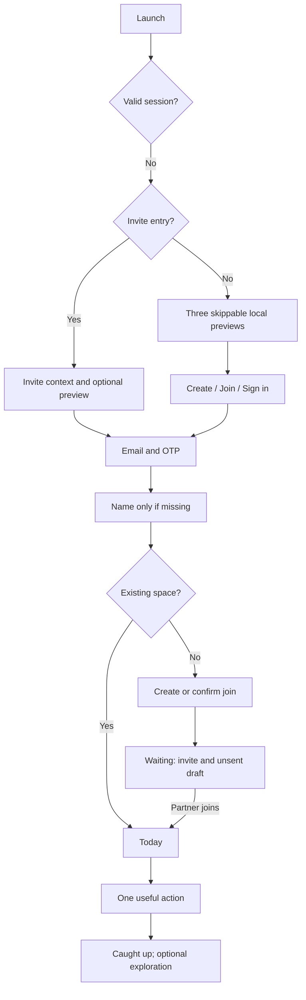

# Between: onboarding and first-session plan

Proposal, 31 October 2026. No application behavior changed. Current evidence and release gates: [product audit](product-audit.md).

## Current journey

`welcome.tsx` → Create our space / Join your partner → `sign-in.tsx` → six-digit `verify.tsx` (skipped in development) → `your-name.tsx` if unnamed → `start.tsx`. Stored create/join intent selects `create.tsx` or `join.tsx`; an invite has precedence. Creator gets `waiting.tsx`; joiner previews identity and accepts. Pairing then goes through `pet-choice.tsx`; active pets additionally require naming at `hatch.tsx`; otherwise Today. Protected routes are driven by `features/space/flow.ts`, not by arbitrary screen redirects alone.

Strengths: passwordless account, preserved invite intent, identity check before joining, two-person consent for pet. Friction: authentication before exploration, create/join decision before demonstration, mandatory pet setup decision before core value, creator cannot enter the normal app while waiting. Returning users also see create/join copy although both eventually use the same login.

## Recommended preview: three slides

Use three because they demonstrate the three distinct promises. A fourth pet slide would overstate an optional feature; show the pet later as optional discovery. Preserve current theme and paper/keepsake language. Show **Skip**, page position, and **Sign in** throughout. Swiping is optional: visible Next works with screen readers and reduced motion. Returning users bypass slides after completing or skipping once, with replay available later. Invite arrivals receive a short invitation-led entry and may skip the tour immediately.

| Slide | Objective / copy | Existing capability | Composition and interaction | Reuse / transition |
|---|---|---|---|---|
| 1 | Demonstrate a personal gesture. **“A little thought. A closer day.”** “Leave a note for them to find whenever they're ready.” | Notes opening and paper choices | One centered closed envelope, sample sender “Your person,” tap **Open sample note**, revealing “Saved you the last cookie.” No artificial unread badges | Presentational `Envelope`, `NoteCard`, `Button`, `Text`; inspect animation props before reuse. Next → discovery; Skip → final create/join choice |
| 2 | Explain answering independently. **“You answer. They answer. You discover.”** “Pick your answer, guess theirs, then compare when you've both finished.” | Choice questions and shared reveal | One short sample question, own-answer and prediction columns. After an explicit sample-answer action show a clearly labeled preset partner answer and miniature report. Always label **Demo · sample answers** | Reuse `ChoiceGrid`/`OptionRow` with local state and theme subscriptions; extract a pure report section from `QuizReveal` rather than mount its data hooks. Next → memory; no real scoring or analytics inferred as shared activity |
| 3 | Make the long-term value tangible. **“Keep the moments that become your story.”** “Photos, little journal entries, and plans you make together.” | Journal/Remember; small reference to existing Future | Two photo frames and one journal excerpt. Tap a sample photo to see a static detail. Bottom action **Create our space** with secondary **Join with an invite** and **Sign in** | Reuse `PhotoFrame`, `WelcomeKeepsake` motifs and typography. Avoid using the network-bound full gallery for two sample assets. Final intent survives authentication |

Copy is proposed, not validated by user research. Use bundled owned sample illustrations/photos; do not present invented partner content as live. No email, notification or photo-library prompt during preview. Motion should explain opening/reveal, not gate taps. Disable autoplay; respect system and app reduced-motion settings. Decorative text can stay fixed-size, real instructions and controls must scale.

## Guest feasibility and safe transfer

Recommend a **local product demo**, not an anonymous live couple account. Pairing and secret quiz reveals need two authenticated members; a pretend second user would misrepresent the feature and create cleanup/privacy problems.

For MVP, sample selections are disposable and explicitly labeled. Save only preview version/completion and create/join intent in a separate local namespace. Demo data must never enter `['me']`, `['space', sid, ...]`, server analytics completion events, widgets or real notification routing. On login, discard sample answers; never import them into a real quiz. Tell the user that samples were practice.

A later “draft your first note” can create an unsent local draft if helpful. Store version, local UUID, body, paper, createdAt, origin=guest and unclaimed owner. After authentication and pairing, ask the user to review recipient and draft, then explicitly send once using a stable operation ID. Claim the draft to the signed-in account; do not expose it to a later account on the same phone. Cancel preserves it locally only for the owner; sign-out offers discard/secure retention policy. Failed adoption retries by the same ID, deduplicated by server; closed spaces never receive a migrated draft. Do not silently share a guest draft or import arbitrary media. Do this only after the durable-draft foundation exists.

## Ideal first session

1. Open app → see sample note immediately; optional three-slide exploration, no account demand.
2. Create / join / sign in are distinct intents through one existing email OTP mechanism.
3. Ask display name only if absent. Keep invite context visible; permit changing email before verification.
4. Create shared space → share invite. While waiting, offer an explicitly unsent first-note draft and a view of what will unlock. This needs a limited waiting experience, not weakening server partner requirements.
5. Joiner sees who invited them and confirms; pairing unlocks Today.
6. Suggest writing/reading one note as the first successful action. Offer Daily if both are present, without requiring the partner to act immediately.
7. Offer pet later from Settings/Today discovery. Record setup as skipped rather than repeatedly prompting. Preserve mutual consent when enabling. This changes flow rules and requires contract/flow tests after approval.
8. Ask notification permission after the user chooses to hear about a partner response, with a clear explanation and a “Later” path.

Activation has two milestones: individual value (a real note sent/opened or meaningful check-in saved) and couple value (partner joins and responds/views a shared artifact). Do not count preview taps as activation.

## Returning and inactive users

Normal return: restore valid session and owned cache → Today → their most useful pending item → “caught up” endpoint. Avoid showing tour again after an update unless the user asks. Inactivity: “Good to see you” plus actual pending content, no countdown or accumulated missed-task wall. Expired session: explain why sign-in is needed and restore a safe intended destination after auth. Invalid invite: explain expired/replaced code and offer retry/new code from partner. Failed `/me`: retain retry and sign-out choices rather than loop through onboarding.

Proposed route map:

## Acceptance and evaluation

No production hook/API call in previews. Skip and Sign in are accessible from each slide; invite survives cold start and OTP retry. Back never accidentally creates a second space. Offline preview loads bundled assets. Test small phones, largest accessibility text, VoiceOver/TalkBack, light/dark four themes, reduced motion, process death, and upgrading a user who already completed onboarding. Native screenshot alone does not verify these.

Measure privacy-safe preview viewed/completed/skipped, auth started/succeeded, invite created/accepted and first individual/couple value. Use an allowlisted slide number/flow version, no note/answer/email in events. Compare time-to-first-real-action and pairing completion, with retention and invite abandonment as guardrails. Start with five couples attempting tasks before an A/B test; do not optimize slide completion as the goal.
